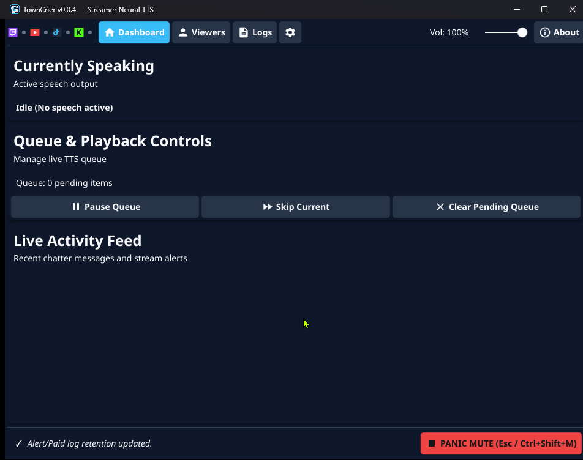
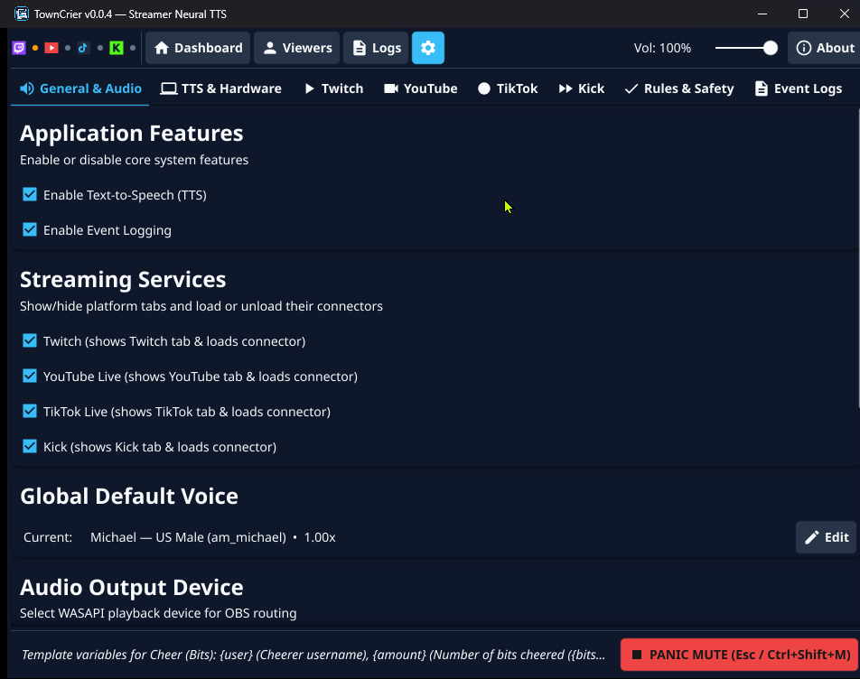
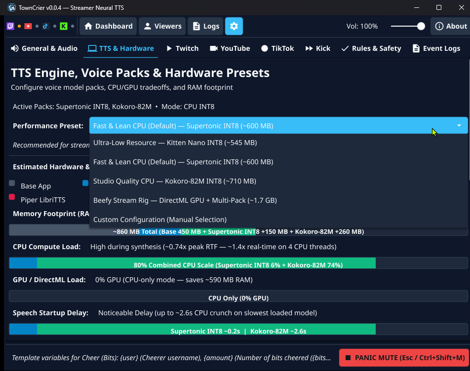
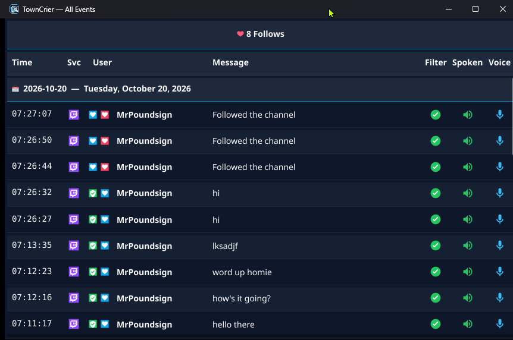
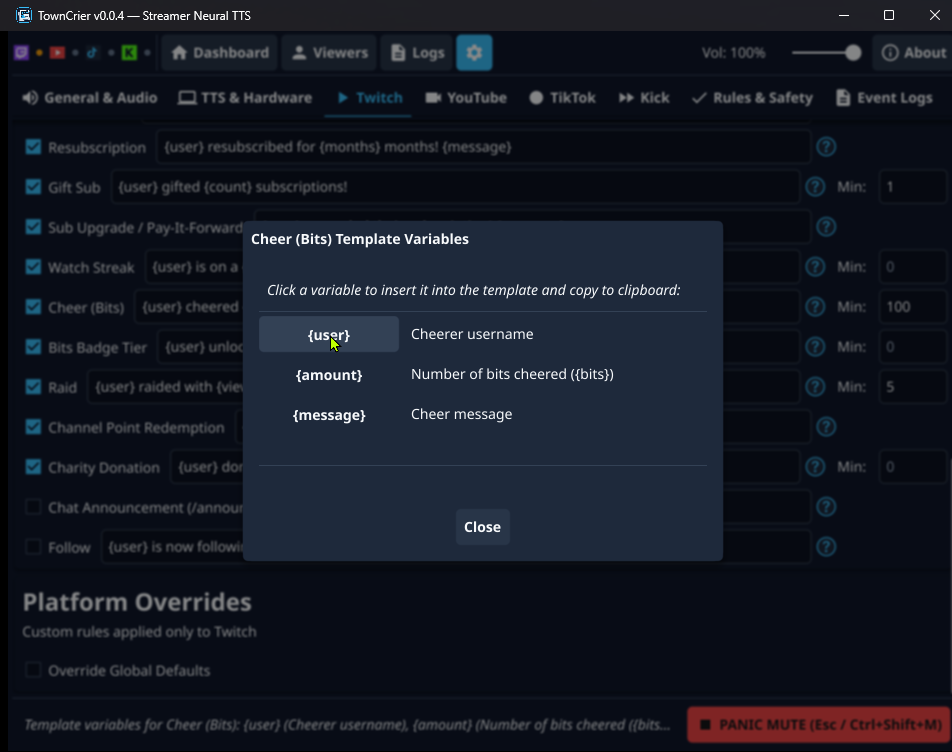

# TownCrier

**TownCrier** is an open-source Windows and Linux desktop application that reads livestream chat and stream alerts aloud using local neural text-to-speech (TTS), or serves as a lightweight, centralized multi-platform chat aggregator and event logger.

Audio routes directly to any selected playback device—such as a virtual audio cable, PipeWire/PulseAudio sink, or dedicated monitor output—allowing OBS Studio to capture TTS on an isolated audio track. Everything runs completely offline on your PC with zero cloud subscriptions, API keys, or character limits.

  

---

## Features

### Modular Application Features
- **Independent TTS & Logging Toggles**: Toggle **Text-to-Speech (TTS)** and **Event Logging** independently in **Settings → General & Audio**.
- **Ultra-Fast Launch (<100ms) & Near-Zero RAM**: When TTS is disabled, TownCrier skips ONNX runtime initialization and model downloads entirely, running as a lean stream monitor and event logger with ~35–45 MB baseline RAM.
- **Dynamic UI Removal**: Disabling features cleanly removes non-applicable navigation tabs, settings sub-tabs, volume sliders, panic buttons, and queue controls rather than simply greying them out.
- **Full Configuration Retention**: All voice assignments, audio devices, hardware presets, speech templates, platform overrides, and retention rules are retained in `config.json` when features are toggled.

  

### Multi-Platform Stream Support
- **Twitch**: Connect immediately with just a channel name via IRC, or connect via OAuth for comprehensive EventSub alerts (Subscriptions, Resubs, Gift Subs, Bits, Raids, Follows, Watch Streaks, Sub Upgrades, Channel Point Redemptions, Bits Badge Milestones, Charity Donations, and Announcements) with IRC/EventSub message deduplication and live moderation sync.
- **YouTube Live**: Read live chat, Super Chats, Super Stickers (rendered inline), New Members, Incoming Raids / Live Redirects, Gift Membership redemptions, and YouTube Giving Charity donations using a channel `@handle`, channel URL, or live video URL—no Google Cloud API keys required.
- **TikTok Live**: Connect to any live `@username` to read chat, follows, stream shares, Super Fan subscriptions/resubs, and gifts (rendered inline). Rapid gift combos are automatically grouped and announced when finished.
- **Kick**: Read live chat, subscriptions, multi-recipient gifted subscriptions, channel reward redemptions, and moderation actions by channel name.
- **Platform Connection Badges**: Real-time vector indicator badges in the top application header display live connection and streaming status for each service.
- **Show or Hide Platforms**: Toggle individual streaming services in **Settings** to keep only active platform tabs visible.

### Local Neural Voice Packs & Hardware Presets
- **Five Offline Voice Models**: Load a single lightweight model or run multiple voice engines simultaneously:
  - **Supertonic (Default)**: Ultra-fast 66M-parameter flow-matching model (10 voices) with near-instant speech start (~0.2s) and light CPU usage.
  - **Kokoro-82M**: Natural voices with all 34 US & UK English voices, featuring optional DirectML GPU acceleration on Windows (~0.3s speech start).
  - **Kokoro International**: Optional multilingual pack adding 25 international voices (Japanese, Mandarin, Spanish, French, Hindi, Italian, and Brazilian Portuguese) sharing the Kokoro engine at 0 MB extra RAM.
  - **Kitten Mini & Kitten Nano**: Ultra-compact distilled voice packs (8 voices each) designed for minimal RAM on single-PC streaming rigs.
  - **Piper LibriTTS-High**: Massive 904-speaker voice catalog for giving every regular chatter a distinct voice.
- **Hardware Presets & Stacked Impact Meters**: Choose a one-click preset (*Ultra-Low Resource*, *Fast & Lean*, *Studio Quality*, *Crowd Mode*, or *Full Arsenal*) or customize voice packs manually. Color-coded stacked bars display real-world process RAM, CPU math, and GPU acceleration usage.
- **Modal Download Progress Dialog**: Seamless in-app downloads with full-window modal interaction locking, determinate progress bars (`Model X of Y`, downloaded MB / total MB, percentage), safe cancellation, and automatic multi-engine hot-reloading.

  

### Logs, Stream Sessions & Live Overlay Pop-Outs
- **Live Logs**: Dedicated sub-tab under **Logs** with savable filter cards and real-time live tail updates.
- **Streamlined Pop-Out Windows**: Launch distraction-free floating windows stripped of toolbars and filter panels—displaying only the live event feed and summary totals, ideal for a second monitor or OBS window capture.
- **Broadcast Stream Sessions**: Automatic broadcast session tracking for Twitch and Kick streams with session start/end timestamps, elapsed `HH:MM:SS` time range filtering, and sticky summary metrics (message volume, alert totals, unique chatter counts).
- **Search History**: Instant SQLite FTS5 trigram full-text search, multi-session selection, date-range filtering, and configurable retention limits.
- **Inline Emotes & Badges**: Rich inline rendering of Twitch, YouTube, and Kick emotes, TikTok gifts, YouTube stickers, and hoverable role badges.

  

### Voice Routing, Reading Rules & Stream Safety
- **Voice Assignment Hierarchy**: Priority-based voice resolution: `Viewer Override` → `Event Alert Voice` → `Platform Override Voice` → `Global Default Voice`.
- **Interactive Template Help**: Centered `(?)` reference modal next to speech templates with click-to-insert variables (`{user}`, `{streak}`, `{recipient}`, `{amount}`, `{cause}`, `{tier}`) and clipboard copy.
- **Role-Gated TTS**: Restrict speech to Broadcaster, Moderators, VIPs, Subscribers, or Followers (Twitch and Kick on-demand follower status with 30-minute TTL cache) and TikTok Fan Club levels.
- **Instant Emergency Stop**: Click **EMERGENCY STOP**, press `Esc` inside the app, or trigger the global hotkey (`Ctrl+Shift+M` default on Windows, customizable in **Settings**) to cut audio buffers instantly (<50µs) and flush the speech queue.
- **Live Moderation Sync**: Message deletions or timeouts/bans on Twitch and Kick immediately purge queued messages and halt playback mid-sentence.
- **Smart Priority Queue**:
  - Subscriptions, Bits, Super Chats, Gifts, Follows, and Raids jump ahead of regular chat with zero queue expiration.
  - Chat messages waiting longer than 30 seconds during fast chat bursts are dropped so TTS stays current with live stream events.
  - Fast catchup mode automatically accelerates speech (`1.3x`) whenever the queue backs up past 5 messages.
- **Bot & Profanity Filtering**: Built-in one-click profanity filter toggle ("Block common profanity & slurs"), custom blocked words/phrases, and known stream bot filtering (`Nightbot`, `StreamElements`, `Fossabot`, `Moobot`, `Sery_Bot`, etc.) with per-viewer allow/ignore overrides.

  

---

## Getting Started

1. **Download and Launch**:
   - Download `TownCrier.exe` (Windows) or `towncrier` (Linux) from [Releases](https://github.com/mrpoundsign/TownCrier/releases).
   - On first launch, TownCrier sets up the default voice pack automatically before opening the Dashboard.
2. **Configure Audio Output**:
   - Open **Settings → General & Audio** and select your playback device (e.g., a virtual audio cable configured as an Audio Output Capture source in OBS).
3. **Connect Your Stream**:
   - In **Settings**, open the **Twitch**, **YouTube**, **TikTok**, or **Kick** sub-tab, enter your channel username or handle, and click **Enable**.
   - Watch the platform connection badge in the top header illuminate when connected.
4. **Monitor & Manage**:
   - Use the **Dashboard** to monitor active speech, skip or pause messages, and assign custom voices to regular chatters.
   - Use **Logs → Live Logs** to pop out real-time chat overlay windows or review past broadcasts in **Logs → Search History**.

---

## License & Legal

TownCrier is licensed under the **GNU Affero General Public License v3.0 (AGPL-3.0)**. See [`LICENSE`](LICENSE) for the full license text and [`THIRDPARTY_NOTICES.md`](THIRDPARTY_NOTICES.md) for third-party library and model attributions.

- [Privacy Policy](https://mrpoundsign.github.io/TownCrier/privacy.html)
- [Terms of Service](https://mrpoundsign.github.io/TownCrier/terms.html)
